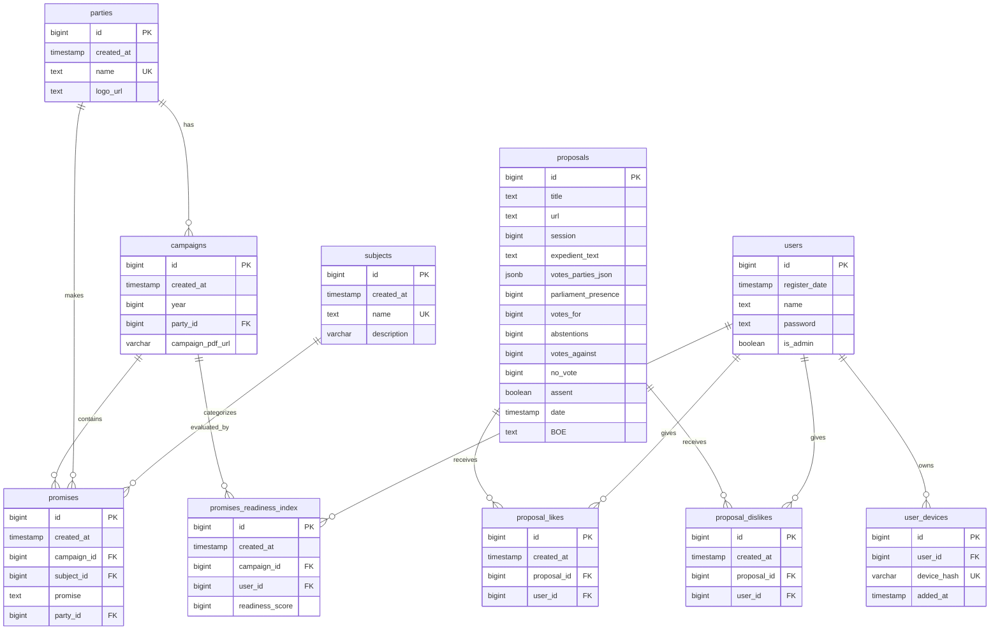

# Demosratio

[Read in English](README.en.md)

Una herramienta online para verificar el cumplimiento de promesas y decisiones políticas, fomentando la transparencia y la participación ciudadana.

## ¿Qué problema soluciona?

Demosratio busca resolver la falta de transparencia en la política, permitiendo a los ciudadanos informarse de manera clara y objetiva sobre las promesas de los políticos y las decisiones que toman. La plataforma evita los filtros políticos de la prensa actual, brindando acceso directo a la información y facilitando la participación ciudadana.

## ¿Cómo funciona?

Demosratio recopila y organiza información sobre las promesas electorales de los políticos y las decisiones que toman en el gobierno. Los usuarios pueden acceder a esta información de forma sencilla, verificar las fuentes oficiales y participar en simulacros de votación.

## Funcionalidades

- **Información clara y accesible**: Base de datos con promesas y decisiones, enlazadas a fuentes oficiales.
- **Seguimiento fácil**: Estado de las promesas (cumplidas, no cumplidas, en curso) y resultados de las decisiones (aprobadas, rechazadas, en curso).
- **Participación ciudadana**: Aportación de información verificable, denuncias de manipulación y simulacros de votación.
- **Visualización de datos**: Gráficos y tablas interactivas para analizar la información.
- **Secciones de la web**:
  - Página principal: Cartas para ver promesas y decisiones recientes.
  - Votos en el congreso: Decisiones ordenadas por fecha. Con búsqueda por texto de expediente.
  - Promesas electorales: Promesas y decisiones agrupadas por temas.
  - Visualización de datos: Gráficos y tablas interactivas. cuando se clicka en los votos
  - Manifiesto: Información sobre el proyecto y sus creadores.

## Tecnologías

- **Frontend**: Next.js, Typescript
- **Backend**: Next.js, Supabase

## Primera instalación

- Antes de la primera instalación se debe hacer una cuenta en [supabase](https://supabase.com/).
- Crea un proyecto en supabase y un documento .env en ROOT del código
- En subapabse: Configuracuón > DATA API Copiar y pegar el `Project URL`, y los 2 `Projet API keys`.
- en el código: `npm run dev` y visitar la url `http://localhost:3000/api/create-tables`

```
# Supabase Configuration
NEXT_PUBLIC_SUPABASE_URL=
NEXT_PUBLIC_SUPABASE_ANON_KEY=
SUPABASE_SERVICE_ROLE_KEY=

# Application Configuration
DAYS_TO_CHECK_VOTES=30 # Cuantos dias de anterioridad quieres ver los votos que se hicieron en el congreso
JWT_KEY=<RANDOM_STRING>
ENCRYPTION_KEY=<GENERATED_ENCRIPTION_KEY> #openssl rand -base64 64 | tr -dc 'a-zA-Z0-9' | head -c 64

```

- Crea un proyecto en supabase
- En la consola: `npx supabase login`
- Ir a Supabase y buscar Database > Migrations y seguir los pasos (añadiendo npx al principio)
  - `npx supabase link --project-ref <TU_PROJECT_REF>`
  - `npx supabase migration new new-migration`
  - Ir a `supabase/migrations/<ID>_new-migration.sql` y pegar el contenido de `schema.sql`
  - `npx supabase db push`

## Base de Datos



## Esquema de la App

```mermaid
%% Generated by https://gitdiagram.com/gabrielmoris/demosratio
flowchart TD

subgraph group_web["Web experience"]
  node_web_pages["Browse views"]
  node_party_state["Party state"]
  node_leg_context["Legislature context"]
end

subgraph group_politics["Political data"]
  node_leg_api["Legislature API<br/>[route.ts]"]
  node_leg_db["Legislature queries<br/>[getLegislaturas.ts]"]
  node_leg_helper["Legislature parsing<br/>[legislatura.ts]"]
  node_roman["Roman numerals<br/>[romanNumerals.ts]"]
  node_party_api["Party routes<br/>[route.ts]"]
  node_campaign_api["Campaign routes<br/>[route.ts]"]
  node_subject_api["Subject routes<br/>[route.ts]"]
  node_promise_routes["Promise routes"]
  node_proposal_routes["Proposal routes"]
  node_proposal_db["Proposal storage"]
  node_supabase["Supabase client<br/>[supabaseClient.ts]"]
end

subgraph group_analysis["Analysis pipeline"]
  node_parliament_cron["Parliament importer<br/>[route.ts]"]
  node_extractor["Parliament extractor"]
  node_promise_ai["Promise analysis"]
  node_gemini["Gemini client<br/>[geminiClient.ts]"]
  node_analysis_db["Analysis storage"]
end

subgraph group_identity["Identity and access"]
  node_auth_guard["Admin authorization<br/>[isAuthorized.ts]"]
  node_users_db["User queries<br/>[users.ts]"]
  node_jwt["JWT helper<br/>[jwt.ts]"]
end

node_citizens(("Citizens"))
node_admin(("Administrators"))

node_citizens -->|"browses"| node_web_pages
node_admin -->|"manages campaigns"| node_campaign_api
node_web_pages -.->|"uses"| node_party_state
node_party_state -->|"reads selection"| node_leg_context
node_party_state -->|"requests parties"| node_party_api
node_party_state -->|"requests campaigns"| node_campaign_api
node_party_state -->|"requests promises"| node_promise_routes
node_leg_context -->|"fetches list"| node_leg_api
node_leg_api -->|"fetches and manages"| node_leg_db
node_leg_api -->|"parses input"| node_leg_helper
node_leg_db -->|"queries"| node_supabase
node_leg_helper -->|"converts numerals"| node_roman
node_party_api -->|"authorizes changes"| node_auth_guard
node_campaign_api -->|"authorizes changes"| node_auth_guard
node_subject_api -->|"authorizes changes"| node_auth_guard
node_parliament_cron -->|"extracts votes"| node_extractor
node_parliament_cron -->|"gets current legislature"| node_leg_db
node_parliament_cron -->|"saves proposals"| node_proposal_db
node_parliament_cron -->|"analyzes promises"| node_promise_ai
node_promise_ai -->|"requests analysis"| node_gemini
node_parliament_cron -->|"stores analyses"| node_analysis_db
node_proposal_routes -.->|"serves proposal data"| node_proposal_db
node_auth_guard -->|"verifies session"| node_jwt
node_auth_guard -->|"checks administrator"| node_users_db
node_users_db -->|"queries"| node_supabase

click node_web_pages "https://github.com/gabrielmoris/demosratio/tree/main/src/app/%5Blocale%5D"
click node_party_state "https://github.com/gabrielmoris/demosratio/blob/main/src/components/Parties/PartyStateManager.tsx"
click node_leg_context "https://github.com/gabrielmoris/demosratio/blob/main/src/context/legislaturaContext.tsx"
click node_leg_api "https://github.com/gabrielmoris/demosratio/blob/main/src/app/api/legislaturas/route.ts"
click node_leg_db "https://github.com/gabrielmoris/demosratio/blob/main/lib/database/legislaturas/getLegislaturas.ts"
click node_leg_helper "https://github.com/gabrielmoris/demosratio/blob/main/lib/helpers/legislatura.ts"
click node_roman "https://github.com/gabrielmoris/demosratio/blob/main/lib/helpers/romanNumerals.ts"
click node_party_api "https://github.com/gabrielmoris/demosratio/blob/main/src/app/api/parties/route.ts"
click node_campaign_api "https://github.com/gabrielmoris/demosratio/blob/main/src/app/api/parties/campaigns/route.ts"
click node_subject_api "https://github.com/gabrielmoris/demosratio/blob/main/src/app/api/parties/subjects/route.ts"
click node_promise_routes "https://github.com/gabrielmoris/demosratio/tree/main/src/app/api/parties/promises"
click node_proposal_routes "https://github.com/gabrielmoris/demosratio/tree/main/src/app/api/spanish-proposals"
click node_proposal_db "https://github.com/gabrielmoris/demosratio/tree/main/lib/database/spanishParliament"
click node_parliament_cron "https://github.com/gabrielmoris/demosratio/blob/main/src/app/api/cron/parliament-data/route.ts"
click node_extractor "https://github.com/gabrielmoris/demosratio/blob/main/lib/helpers/spanishParliamentExtractor/getParliamentData.ts"
click node_promise_ai "https://github.com/gabrielmoris/demosratio/blob/main/lib/services/ai/promisesAnaliseAI.ts"
click node_gemini "https://github.com/gabrielmoris/demosratio/blob/main/lib/services/geminiClient.ts"
click node_analysis_db "https://github.com/gabrielmoris/demosratio/blob/main/lib/database/parties/promises/promises-analysis/setPromisesAnalysis.ts"
click node_auth_guard "https://github.com/gabrielmoris/demosratio/blob/main/src/middleware/isAuthorized.ts"
click node_users_db "https://github.com/gabrielmoris/demosratio/blob/main/lib/database/users/users.ts"
click node_jwt "https://github.com/gabrielmoris/demosratio/blob/main/lib/helpers/users/jwt.ts"
click node_supabase "https://github.com/gabrielmoris/demosratio/blob/main/lib/supabaseClient.ts"

classDef toneNeutral fill:#f8fafc,stroke:#334155,stroke-width:1.5px,color:#0f172a
classDef toneBlue fill:#dbeafe,stroke:#2563eb,stroke-width:1.5px,color:#172554
classDef toneAmber fill:#fef3c7,stroke:#d97706,stroke-width:1.5px,color:#78350f
classDef toneMint fill:#dcfce7,stroke:#16a34a,stroke-width:1.5px,color:#14532d
classDef toneRose fill:#ffe4e6,stroke:#e11d48,stroke-width:1.5px,color:#881337
classDef toneIndigo fill:#e0e7ff,stroke:#4f46e5,stroke-width:1.5px,color:#312e81
classDef toneTeal fill:#ccfbf1,stroke:#0f766e,stroke-width:1.5px,color:#134e4a
class node_web_pages,node_party_state,node_leg_context toneBlue
class node_leg_api,node_leg_db,node_leg_helper,node_roman,node_party_api,node_campaign_api,node_subject_api,node_promise_routes,node_proposal_routes,node_proposal_db,node_supabase toneAmber
class node_parliament_cron,node_extractor,node_promise_ai,node_gemini,node_analysis_db toneMint
class node_auth_guard,node_users_db,node_jwt toneRose
class node_citizens,node_admin toneIndigo
```


## Instalación

1.  Clona el repositorio: `git clone git@github.com:gabrielmoris/Demosratio.git`
2.  Navega al directorio del proyecto: `cd Demosratio`
3.  Instala las dependencias: `npm install`
4.  Inicia el servidor de desarrollo: `npm run next dev`

## Contribución

¡Las contribuciones son bienvenidas! Si deseas contribuir al proyecto, por favor, sigue estos pasos:

1.  Haz un fork del repositorio.
2.  Crea una nueva rama para tu contribución: `git checkout -b mi-contribucion`
3.  Realiza tus cambios y asegúrate de que las pruebas pasen.
4.  Envía un pull request con una descripción clara de tus cambios.

## Licencia

Este proyecto está bajo la Licencia Pública General de GNU v3.0.

## Creadores

- Gabriel Moris

## Contacto

Puedes contactarnos a través de nuestro perfil de GitHub: <https://github.com/gabrielmoris>

## Convención de branching

Utilizaremos la siguiente convención de branching:

- `main`: Rama principal con el código en producción.
- `develop`: Rama de desarrollo donde se integran los cambios.
- `feature/nombre-de-la-funcionalidad`: Ramas para desarrollar nuevas funcionalidades.
- `bugfix/nombre-del-error`: Ramas para corregir errores.

## Próximos pasos

- Implementar pruebas unitarias y de integración.
- Configurar el proceso de despliegue.
